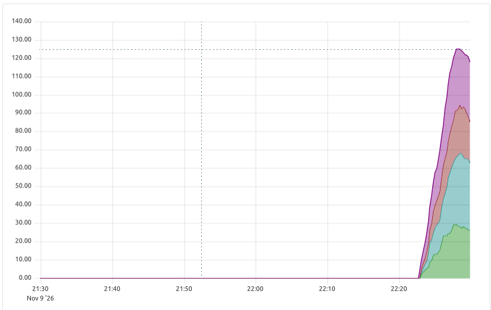
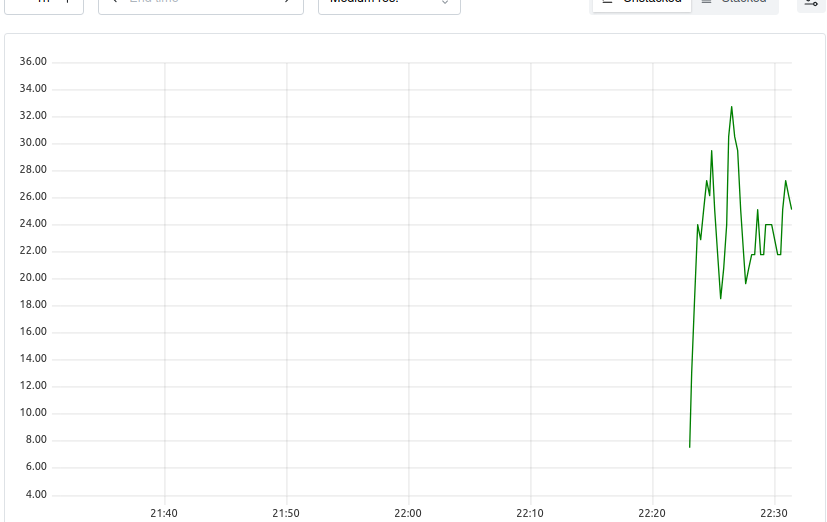

# Mobile Price Classification

Проект машинного обучения для классификации мобильных телефонов по четырём ценовым категориям (`price_range`: 0–3). Он охватывает разведочный анализ данных, подготовку признаков, обучение и оценку моделей, эксперименты с MLflow, создание REST API на FastAPI и мониторинг контейнеризованного сервиса.

**Технологии:** Python, Pandas, NumPy, scikit-learn, Optuna, MLflow, FastAPI, Uvicorn, Docker, Docker Compose, Prometheus, Prometheus Python Client, Grafana. Для исследования и визуализации данных использовались Jupyter Notebook и графические библиотеки из предыдущих лабораторных работ.

## Этапы проекта

- **ЛР1:** настройка окружения, разведочный анализ данных и подготовка датасета.
- **ЛР2:** Feature Engineering, отбор признаков, подбор параметров RandomForest и регистрация Production-модели в MLflow.
- **ЛР3:** REST API для предсказаний, загрузка `model.pkl`, контейнеризация с Docker.
- **ЛР4:** генерация тестовых запросов, экспорт метрик, Prometheus и дашборд Grafana.

---

# Лабораторная работа №1

Настройка окружения и разведочный анализ данных.

## Описание проекта

В проекте проводится разведочный анализ данных датасета **Mobile Price Classification**.

Задача — исследовать характеристики мобильных телефонов и подготовить данные
для дальнейшего построения модели классификации ценового диапазона телефона.

Целевая переменная:

`price_range`

Она принимает четыре значения:

- `0` — низкая ценовая категория
- `1` — средняя ценовая категория
- `2` — высокая ценовая категория
- `3` — очень высокая ценовая категория

## Датасет

Используется датасет:

**Mobile Price Classification**

Источник:

https://www.kaggle.com/datasets/iabhishekofficial/mobile-price-classification

Для анализа используется файл:

`data/train.csv`

Файлы с данными не сохраняются в Git-репозитории.

## Структура проекта

Структура на этапе ЛР1:

```text
ml_lab/
├── data/
│   ├── train.csv
│   ├── test.csv
│   └── clean_dataset.pkl
│
├── eda/
│   ├── eda.ipynb
│   ├── graph1_price_range.png
│   ├── graph2_ram_price.png
│   ├── graph3_battery_price.png
│   ├── graph4_correlation.png
│   ├── graph5_wifi.png
│   ├── graph6_interactive.html
│   └── graph7_pixel_area.png
│
├── .gitignore
├── README.md
└── requirements.txt
```

# Лабораторная работа №2

## Проведение экспериментов по настройке модели

Во второй лабораторной работе проведены эксперименты по настройке модели
для задачи классификации ценового диапазона мобильного телефона.

В качестве основной модели используется `RandomForestClassifier`.

Для отслеживания экспериментов используется MLflow.

## Подготовка данных

Для экспериментов используется очищенный датасет, полученный в результате
выполнения лабораторной работы №1:

`data/clean_dataset.pkl`

Целевая переменная:

`price_range`

Данные разделены на обучающую и тестовую выборки в соотношении:

- train — 75%
- test — 25%

Для сохранения распределения классов используется стратифицированное
разделение.

## Pipeline baseline-модели

Baseline pipeline состоит из двух этапов:

1. Обработка признаков.
2. Обучение модели.

Для числовых признаков используется:

`StandardScaler`

Для категориальных признаков используется:

`TargetEncoder`

В качестве модели используется:

`RandomForestClassifier`

Для оценки качества используются метрики:

- Precision
- Recall
- F1-score
- ROC AUC

## Feature Engineering

Для расширения пространства признаков использовались средства `scikit-learn`.

Применялись:

- `PolynomialFeatures` с `degree=2`;
- `KBinsDiscretizer`;
- `StandardScaler`;
- `TargetEncoder`.

Для PolynomialFeatures и KBinsDiscretizer использовались признаки:

- `ram`
- `battery_power`
- `pixel_area`

До преобразований использовался 21 признак.

После Feature Engineering был получен 51 признак.

Названия сформированных признаков сохранены в файле:

`research/sklearn_feature_names.txt`

## Feature Selection

После Feature Engineering был выполнен отбор наиболее значимых признаков.

При выборе использовались результаты разведочного анализа данных,
полученные в лабораторной работе №1.

Основное внимание уделялось признакам, связанным с:

- `ram`
- `battery_power`
- `pixel_area`
- `px_height`
- `px_width`

Индексы выбранных признаков сохранены в:

`research/selected_indices.txt`

Названия выбранных признаков сохранены в:

`research/selected_features.txt`

## Подбор гиперпараметров

Для настройки RandomForest используется библиотека `Optuna`.

Подбираются следующие параметры:

- `n_estimators`
- `max_depth`
- `max_features`

Проведено не менее 10 trials.

В качестве оптимизируемой метрики используется `F1-score`.

Так как большее значение F1 соответствует лучшему качеству модели,
направление оптимизации задано как:

`maximize`

Результаты Optuna сохранены в:

`research/optuna_trials.txt`

## MLflow

MLflow запускается локально.

В качестве backend store используется SQLite.

Для запуска MLflow необходимо перейти в директорию:

```bash
cd mlflow
sh start_mlflow.sh
```

После запуска интерфейс MLflow доступен по адресу:

http://localhost:5000

В нём можно просмотреть эксперименты, прогоны, метрики и зарегистрированные модели.

Модель зарегистрирована под именем `mobile-price-classifier`.
Production-версия выбирается в реестре моделей по тегу `Production=true`.
Её `run_id` используется при выгрузке модели для ЛР3.

---

# Лабораторная работа №3

## Создание сервиса предсказаний

В третьей лабораторной работе создан REST API для предсказания ценовой категории
мобильного телефона на основе Production-модели, обученной в ЛР2.

Сервис разработан на **FastAPI**, запускается сервером **Uvicorn** и
разворачивается в **Docker-контейнере**. Модель загружается из файла `model.pkl`.

На вход подаются характеристики телефона, на выходе возвращается класс
`price_range` от `0` до `3`.

## Структура сервиса

```text
ml_lab/
├── data/
│   ├── train.csv
│   ├── test.csv
│   └── clean_dataset.pkl
├── eda/
│   └── ...
├── research/
│   ├── research.ipynb
│   ├── production_features.txt
│   └── ...
├── mlflow/
│   ├── start_mlflow.sh
│   ├── mlruns.db
│   └── mlartifacts/
├── services/
│   ├── ml_service/
│   │   ├── main.py
│   │   ├── api_handler.py
│   │   ├── requirements.txt
│   │   └── Dockerfile
│   └── models/
│       ├── get_model.py
│       └── model.pkl
├── .gitignore
├── README.md
└── requirements.txt
```

Назначение файлов:

| Файл | Назначение |
| --- | --- |
| `services/ml_service/main.py` | Создание FastAPI-приложения и обработка HTTP-запросов. |
| `services/ml_service/api_handler.py` | Класс `FastAPIHandler`, загрузка модели и вызов `predict()`. |
| `services/ml_service/requirements.txt` | Зависимости, устанавливаемые в Docker-образ. |
| `services/ml_service/Dockerfile` | Инструкции сборки образа и запуска сервиса. |
| `services/models/get_model.py` | Скачивание Production-модели из MLflow по `run_id`. |
| `services/models/model.pkl` | Обученная модель для локального инференса. |

## Подготовка окружения

Перейти в корень проекта и активировать окружение:

```bash
cd ~/ml_lab
source .venv_ml_lab/bin/activate
pip install -r requirements.txt
```

## Получение модели из MLflow

Запустить MLflow в отдельном терминале:

```bash
cd ~/ml_lab/mlflow
sh start_mlflow.sh
```

Открыть http://localhost:5000, найти зарегистрированную модель
`mobile-price-classifier`, её версию с тегом `Production=true` и скопировать `run_id`.

Указать этот идентификатор в `services/models/get_model.py`.
В другом терминале выполнить:

```bash
cd ~/ml_lab
source .venv_ml_lab/bin/activate
python services/models/get_model.py
ls -lh services/models/model.pkl
```

Файл `model.pkl` должен появиться в каталоге `services/models/`.
После выгрузки модели MLflow не требуется для обработки HTTP-запросов.

## Локальный запуск FastAPI

```bash
cd ~/ml_lab/services/ml_service
uvicorn main:app --reload --host 127.0.0.1 --port 8000
```

После запуска открывается Swagger UI: http://localhost:8000/docs.

Проверка корневого маршрута:

```bash
curl http://localhost:8000/
```

Ожидаемый ответ:

```json
{"Hello":"World"}
```

Перед запуском контейнера остановить локальный сервер сочетанием `Ctrl+C`,
чтобы освободить порт `8000`.

## Docker: сборка образа

Используется базовый образ `python:3.11-slim`.

```bash
cd ~/ml_lab/services/ml_service
docker build -t mobile-price-service:1 .
```

- `-t mobile-price-service:1` — название образа и его версия.
- `.` — контекст сборки (текущая директория).

Проверка наличия образа:

```bash
docker images
```

## Docker: запуск контейнера

Команда выполняется **из папки `services/ml_service`**:

```bash
cd ~/ml_lab/services/ml_service
docker run -d \
  --name mobile-price-service \
  -p 8000:8000 \
  -v "$(pwd)/../models:/models:ro" \
  mobile-price-service:1
```

Аргументы команды:

- `-d` — фоновый режим;
- `--name` — имя контейнера;
- `-p 8000:8000` — связь порта хоста `8000` с портом контейнера `8000`;
- `-v` — подключение директории `services/models/` к `/models` внутри контейнера;
- `:ro` — доступ к модели только для чтения.

Контейнер читает обученную модель по пути `/models/model.pkl`.
Сам файл модели не требуется включать в Docker-образ.

## Проверка контейнера

```bash
docker ps
docker logs mobile-price-service
```

Интерфейс API: http://localhost:8000/docs.

## API сервиса

### GET `/`

Проверка доступности приложения:

```bash
curl http://localhost:8000/
```

Ответ:

```json
{"Hello":"World"}
```

### POST `/api/prediction`

`item_id` передаётся как параметр URL, характеристики телефона — в JSON-теле запроса.

Пример запроса:

```bash
curl -X POST \
  "http://localhost:8000/api/prediction?item_id=123" \
  -H "Content-Type: application/json" \
  -d '{
    "battery_power": 842,
    "blue": 0,
    "clock_speed": 2.2,
    "dual_sim": 0,
    "fc": 1,
    "four_g": 0,
    "int_memory": 7,
    "m_dep": 0.6,
    "mobile_wt": 188,
    "n_cores": 2,
    "pc": 2,
    "px_height": 20,
    "px_width": 756,
    "ram": 2549,
    "sc_h": 9,
    "sc_w": 7,
    "talk_time": 19,
    "three_g": 0,
    "touch_screen": 0,
    "wifi": 1,
    "pixel_area": 15120
  }'
```

Список входных признаков должен соответствовать файлу
`research/production_features.txt` из ЛР2.

Пример структуры ответа (конкретный класс зависит от модели):

```json
{
  "item_id": 123,
  "predict": 1
}
```

`predict` — предсказанная ценовая категория: 0, 1, 2 или 3.
Преобразования признаков выполняются обученным Pipeline из ЛР2.

## Управление контейнером

```bash
# Показать запущенные контейнеры
docker ps

# Просмотреть логи
docker logs mobile-price-service

# Остановить контейнер
docker stop mobile-price-service

# Запустить существующий контейнер
docker start mobile-price-service

# Перезапустить контейнер
docker restart mobile-price-service

# Удалить контейнер перед повторным docker run
docker rm -f mobile-price-service
```

Для пересборки после изменения исходного кода:

```bash
cd ~/ml_lab/services/ml_service
docker rm -f mobile-price-service
docker build -t mobile-price-service:1 .
docker run -d --name mobile-price-service -p 8000:8000 -v "$(pwd)/../models:/models:ro" mobile-price-service:1
```

## Результат ЛР3

Подготовлен сервис, который принимает характеристики мобильного телефона
через HTTP POST, выполняет предсказание сохранённой ML-моделью и возвращает
JSON с идентификатором объекта и его ценовой категорией.

Сервис можно запускать как локально с Uvicorn, так и в Docker-контейнере.

---

# Лабораторная работа №4

## Доработка сервиса предсказаний. Мониторинг

### Цель работы

В четвёртой лабораторной работе сервис предсказания ценовой категории мобильного телефона был дополнен генератором тестовых запросов и системой мониторинга. Все компоненты объединены в Docker Compose. **Prometheus** собирает метрики работы API и модели, а **Grafana** отображает их на дашборде.

Необязательная часть с PostgreSQL и pgAdmin в текущую конфигурацию не входит. Для демонстрации изменения входных данных предусмотрено изменение распределения признака `ram` в генераторе запросов.

### Архитектура

```text
 data/train.csv
      |
      v
 +------------------+        POST /api/prediction        +------------------+
 | requests         | --------------------------------> | ml_service       |
 | requests.py      |                                   | FastAPI + model  |
 +------------------+                                   +------------------+
                                                                |
                                                                | GET /metrics
                                                                v
                                                        +------------------+
                                                        | Prometheus       |
                                                        | сбор метрик      |
                                                        +------------------+
                                                                |
                                                                | PromQL
                                                                v
                                                        +------------------+
                                                        | Grafana          |
                                                        | дашборд          |
                                                        +------------------+
```

Внутри Docker Compose сервисы обращаются друг к другу по именам (`ml_service`, `prometheus`), а не через `localhost`.

### Структура файлов ЛР4

```text
services/
├── compose.yml
├── ml_service/
│   ├── main.py
│   ├── api_handler.py
│   ├── monitoring.py
│   ├── requirements.txt
│   └── Dockerfile
├── models/
│   └── model.pkl
├── requests/
│   ├── requests.py
│   ├── requirements.txt
│   └── Dockerfile
├── prometheus/
│   ├── prometheus.yml
│   └── screenshots/
│       ├── predictions.png
│       ├── request_rate.png
│       └── http_errors.png
└── grafana/
    ├── dashboards/
    │   └── mobile-price.json
    ├── provisioning/
    │   ├── datasources/
    │   │   └── prometheus.yml
    │   └── dashboards/
    │       └── dashboard.yml
    └── screenshots/
        └── dashboard.png
```

Файлы `monitoring.py` и `prometheus.yml` отвечают соответственно за экспорт и сбор метрик. В `compose.yml` описаны контейнеры, их порты, зависимости и тома. Файл `grafana/dashboards/mobile-price.json` содержит экспорт дашборда, который можно хранить в Git и повторно импортировать. Конфигурации `grafana/provisioning/` позволяют автоматически подключать Prometheus и загружать сохранённый дашборд.

Скриншоты из каталогов `screenshots/` нужно сохранить после запуска и проверки графиков: они не создаются автоматически командами Docker.

### Генератор запросов

Скрипт `services/requests/requests.py` выбирает случайный телефон из `data/train.csv`, формирует JSON с признаками и отправляет его в `POST /api/prediction` с параметром `item_id`. После каждого запроса программа ожидает случайное время от **0 до 5 секунд** и отправляет следующий запрос.

Особенности генератора:

- используются признаки реальных строк обучающего набора; целевая переменная `price_range` в запрос не включается;
- признак `pixel_area` рассчитывается как `px_height * px_width`;
- адрес API задаётся через `ML_SERVICE_URL`, путь к CSV — через `DATASET_PATH`;
- используются модули стандартной библиотеки Python, поэтому файл `requests/requirements.txt` может быть пустым;
- при `RAM_SHIFT_PROB=0` значения `ram` берутся из исходных строк; ненулевое значение параметра позволяет искусственно изменить распределение RAM и продемонстрировать возможный data shift.

Для локального запуска генератора, когда FastAPI уже работает на порту 8000:

```bash
cd ~/ml_lab
ML_SERVICE_URL=http://localhost:8000/api/prediction \
DATASET_PATH="$PWD/data/train.csv" \
python -u services/requests/requests.py
```

При запуске через Compose используется внутренний адрес `http://ml_service:8000/api/prediction`. Для остановки локального генератора используется `Ctrl+C`.

### Docker Compose: сборка и запуск

Для запуска требуется Docker с поддержкой `docker compose` (Compose V2). Перед стартом должны существовать файлы `data/train.csv` и `services/models/model.pkl`. Модель выгружается из MLflow по инструкции ЛР3; в Git она не хранится.

Из корня проекта:

```bash
cd ~/ml_lab

# Проверить конфигурацию
sudo docker compose -f services/compose.yml config -q

# Собрать образы и запустить все сервисы в фоне
sudo docker compose -f services/compose.yml up -d --build

# Проверить контейнеры
sudo docker compose -f services/compose.yml ps

# Посмотреть логи генератора
sudo docker compose -f services/compose.yml logs -f requests

# Посмотреть логи API
sudo docker compose -f services/compose.yml logs -f ml_service

# Остановить проект, сохранив тома с данными
sudo docker compose -f services/compose.yml down
```

Перед запуском Compose необходимо остановить контейнер ЛР3, если он занимает порт 8000:

```bash
sudo docker rm -f mobile-price-service
```

В ЛР4 используется образ `mobile-price-service:2` (в ЛР3 — `mobile-price-service:1`). Для работы Prometheus и Grafana применяются официальные образы `prom/prometheus` и `grafana/grafana`.

### Веб-интерфейсы и проверка

| Компонент | Адрес | Назначение |
| --- | --- | --- |
| FastAPI | `http://localhost:8000` | Основной ML-сервис |
| Swagger UI | `http://localhost:8000/docs` | Ручное тестирование API |
| Метрики FastAPI | `http://localhost:8000/metrics` | Метрики в формате Prometheus |
| Prometheus | `http://localhost:9090` | PromQL и графики |
| Prometheus Targets | `http://localhost:9090/targets` | Проверка состояния сбора метрик |
| Grafana | `http://localhost:3000` | Дашборд мониторинга |

Для учебного экземпляра Grafana используются логин и пароль `admin` / `admin`. Такие учётные данные нельзя использовать для публично доступного сервиса.

Проверить доступность API и экспорт метрик можно командами:

```bash
curl http://localhost:8000/
curl -s http://localhost:8000/metrics | grep '^model_prediction_bucket'
curl -s http://localhost:8000/metrics | grep '^http_requests_total'
```

В разделе **Targets** интерфейса Prometheus цель `ml_service:8000` должна иметь статус **UP**. Для этого в `services/prometheus/prometheus.yml` указывается адрес `ml_service:8000` и путь `/metrics`.

### Метрики сервиса

| Метрика | Тип | Что измеряет |
| --- | --- | --- |
| `model_prediction` | Histogram | Накопительное распределение предсказанных классов 0–3 |
| `model_predictions_total` | Counter | Число предсказаний по отдельным классам (`price_range`) |
| `http_requests_total` | Counter | Число запросов в разрезе метода, пути и HTTP-статуса |
| `http_request_duration_seconds` | Histogram | Длительность обработки HTTP-запросов |
| `model_input_ram` | Histogram | Распределение входного значения оперативной памяти |
| `process_resident_memory_bytes` | Gauge | Использование оперативной памяти процессом Python |

Для `model_prediction` используются границы `0`, `1`, `2`, `3`: результат классификатора является целым числом. В Prometheus гистограммы **накопительные**: корзина `le="2.0"` включает классы 0, 1 и 2. Корзина `+Inf` добавляется автоматически и охватывает все наблюдения. Её можно исключить **только из графика**, добавив фильтр `le!="+Inf"` в PromQL.

Для наглядного сравнения **отдельных** классов используется `model_predictions_total`: в отличие от накопительной гистограммы, эта метрика сразу показывает число предсказаний 0, 1, 2 и 3 по отдельности.

### Графики в Prometheus

**1. Гистограмма предсказаний.** Показывает, как распределяются предсказания по накопительным корзинам за последние пять минут. Техническая корзина `+Inf` исключена из отображения:

```promql
sum by (le) (
  increase(model_prediction_bucket{le!="+Inf"}[5m])
)
```



**2. Частота запросов в минуту.** Вычисляется по счётчику HTTP-запросов к основному endpoint:

```promql
sum(rate(http_requests_total{path="/api/prediction"}[1m])) * 60
```



**3. Количество ошибок 4xx и 5xx.** На одном графике отображаются две линии, соответствующие количеству клиентских и серверных ошибок за последние пять минут:

```promql
# Запрос A: ошибки 4xx
sum(increase(http_requests_total{path="/api/prediction",status=~"4.."}[5m])) or vector(0)
```

```promql
# Запрос B: ошибки 5xx
sum(increase(http_requests_total{path="/api/prediction",status=~"5.."}[5m])) or vector(0)
```


Для проверки учёта ошибок валидации можно отправить некорректный запрос:

```bash
curl -i -X POST \
  'http://localhost:8000/api/prediction?item_id=999' \
  -H 'Content-Type: application/json' \
  -d '{}'
```

FastAPI должен вернуть HTTP 422 (отсутствуют обязательные поля). Ошибки 5xx возникают при сбоях на стороне сервера; специально провоцировать их для демонстрации не требуется. Величина `increase()` может быть дробной из-за экстраполяции показаний Prometheus.

### Дашборд Grafana

В Grafana настроен источник данных **Prometheus** с внутренним адресом `http://prometheus:9090`. Конфигурация дашборда хранится в `services/grafana/dashboards/mobile-price.json`.

Дашборд включает семь графиков:

| График | Уровень | Описание |
| --- | --- | --- |
| **API Requests per Minute** | Прикладной | Интенсивность поступления запросов к `/api/prediction` в минуту |
| **HTTP Errors** | Прикладной | Число ответов с ошибками 4xx и 5xx за пятиминутный интервал |
| **Predictions by Price Range** | Модель | Количество предсказаний по классам 0, 1, 2 и 3 по отдельности |
| **API Response Time P95** | Производительность | Оценка 95-го процентиля времени ответа API |
| **ML Service Memory Usage** | Инфраструктурный | Объём оперативной памяти, занятой процессом ML-сервиса |
| **Input RAM Above 3072 MB** | Данные модели | Доля запросов с `ram > 3072`, позволяющая заметить изменение состава входных данных |
| **Prediction Histogram** | Модель | Накопительное распределение предсказаний в корзинах Histogram |


Для графика **Predictions by Price Range** используется запрос:

```promql
sum by (price_range) (
  increase(model_predictions_total[5m])
)
```

Это позволяет показывать независимые классы, а не вычитать значения накопительных корзин. Классы модели имеют номера **0–3**, а не 1–4.

Время ответа P95 вычисляется следующим образом:

```promql
histogram_quantile(
  0.95,
  sum by (le) (
    rate(http_request_duration_seconds_bucket{path="/api/prediction"}[5m])
  )
)
```

Для демонстрации возможного изменения распределения входных данных можно временно включить изменение RAM у части тестовых запросов:

```bash
cd ~/ml_lab
RAM_SHIFT_PROB=0.8 sudo -E docker compose -f services/compose.yml up -d --force-recreate requests
```

После наблюдения графиков обычный режим возвращается командой:

```bash
sudo docker compose -f services/compose.yml up -d --force-recreate requests
```

При использовании этого режима необходимо проверить, что переменная `RAM_SHIFT_PROB` действительно передаётся в контейнер через `compose.yml`. При `0.8` примерно 80% запросов будут содержать искусственно увеличенное значение RAM. Изменение графика — **признак возможного data shift**, но не доказательство снижения качества модели. Для полноценного контроля качества нужны истинные метки классов и сравнение с эталонным распределением обучающей выборки.

### Результат ЛР4

Разработан составной сервис из генератора запросов, FastAPI, Prometheus и Grafana. Тестовые данные автоматически поступают в API, а показатели нагрузки, ошибок, времени ответа, распределения предсказаний и ресурсов процесса отображаются в системе мониторинга. Конфигурация контейнеров и файл дашборда подготовлены для хранения в Git.

